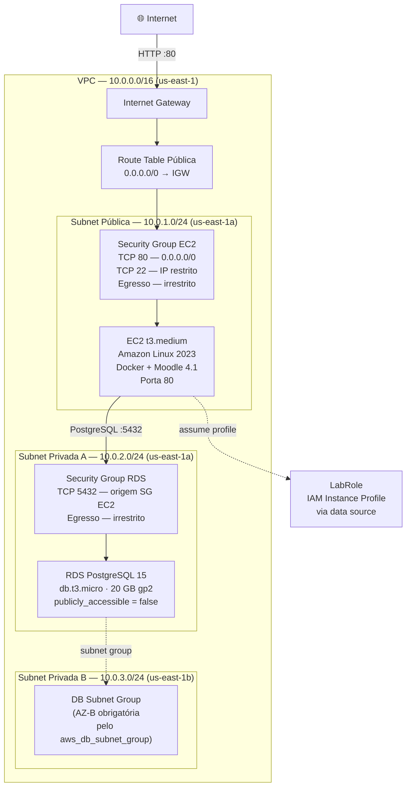

# Design de Arquitetura — Moodle Docker AWS Challenge

---

## Visão Geral

Esta solução implanta o Moodle 4.1 em uma instância EC2 (`t3.medium`) rodando Docker na região `us-east-1` da AWS, conectada a um banco de dados gerenciado RDS PostgreSQL 15 (`db.t3.micro`) em subnet privada. Toda a infraestrutura é provisionada via Terraform, estruturada em três módulos independentes: `networking`, `compute` e `database`.

O ambiente respeita as restrições do AWS Academy Learner Lab: nenhum recurso IAM é criado diretamente — o perfil `LabRole` pré-existente é referenciado via data source. Serviços como Route 53, ACM e CloudFront não são utilizados, pois estão bloqueados no Lab. O acesso externo ao Moodle ocorre pela porta 80 do DNS público gerado automaticamente pela AWS para a instância EC2.

O isolamento de rede é garantido pela topologia de subnets: a EC2 fica em subnet pública com IP público, enquanto o RDS reside em subnets privadas sem rota de saída para a internet. A comunicação entre Moodle e banco de dados ocorre internamente na VPC pela porta 5432, com acesso controlado por security groups com princípio do menor privilégio.

A inicialização do ambiente na EC2 é totalmente automatizada pelo script `user_data.sh`, renderizado pelo `templatefile()` do Terraform com as credenciais e o endpoint do RDS injetados em tempo de provisionamento. O script instala Docker, clona o repositório, cria o `.env` em runtime e sobe o Moodle com `docker compose up -d` sem intervenção manual.

---

## Diagrama de Arquitetura

> A subnet privada B (us-east-1b) existe exclusivamente para satisfazer o requisito de 2 AZs distintas do `aws_db_subnet_group`. Nenhuma instância RDS ativa fica nela.

---

## Decisões de Design

| Componente | Escolha | Justificativa |
|---|---|---|
| Tipo de instância EC2 | `t3.medium` | 2 vCPUs e 4 GB RAM são suficientes para o Moodle em carga educacional. O tipo `t3` está disponível no Learn Lab e oferece burst de CPU quando necessário. |
| Engine do banco de dados | RDS PostgreSQL 15 | Alinha com o ambiente Docker local (`postgres:15`) — mesma versão em desenvolvimento e produção, eliminando incompatibilidades. Suportado no Learn Lab. |
| Classe da instância RDS | `db.t3.micro` | Instância de menor custo disponível no Learn Lab; suficiente para carga de estudo com um usuário admin. Minimiza consumo de crédito do Lab. |
| AMI da EC2 | Amazon Linux 2023 (via SSM) | AMI mantida pela AWS, com suporte nativo a Docker via `dnf`. O parâmetro SSM `/aws/service/ami-amazon-linux-latest/al2023-ami-kernel-default-x86_64` resolve sempre a versão mais recente sem hardcode de ID. |
| Topologia de rede | 1 subnet pública + 2 privadas | EC2 em subnet pública para receber tráfego HTTP e SSH; RDS em subnet privada por segurança (sem IP público). Duas AZs privadas são exigidas pelo `aws_db_subnet_group`. |
| Acesso IAM na EC2 | `LabRole` via data source | O Learn Lab proíbe criação de `aws_iam_role` e `aws_iam_instance_profile`. O perfil `LabRole` pré-existente é referenciado sem criar nenhum recurso IAM, evitando `AccessDenied` no apply. |
| SSL no RDS | `rds.force_ssl = 0` via parameter group | O RDS PostgreSQL 15 tem SSL obrigatório por padrão. Como o ambiente educacional não possui certificado de CA distribuído no container, o SSL obrigatório é desabilitado via parameter group customizado. Em produção, manter `rds.force_ssl = 1` e configurar `sslmode=require` no Moodle. |
| Backend Terraform | Local (padrão) | O backend S3 + DynamoDB é opcional no desafio. A criação do bucket e da tabela DynamoDB pode ser restrita em algumas contas do Lab; o backend local evita esse bloqueio. |
| `skip_final_snapshot` | `true` | Permite executar `terraform destroy` sem aguardar a criação de snapshot — essencial para encerrar o Lab sem custo adicional ou timeout. |

---

## Componentes

### VPC

VPC principal com CIDR `10.0.0.0/16`, `enable_dns_hostnames = true` e `enable_dns_support = true`. O DNS habilitado é necessário para que a EC2 receba um hostname público no formato `ec2-X-X-X-X.compute-1.amazonaws.com`, usado como `wwwroot` do Moodle.

### Subnets

| Nome | Tipo | CIDR | AZ | Recurso hospedado |
|---|---|---|---|---|
| `moodle-challenge-subnet-public` | Pública | `10.0.1.0/24` | us-east-1a | EC2 (Moodle) |
| `moodle-challenge-subnet-private-a` | Privada | `10.0.2.0/24` | us-east-1a | RDS PostgreSQL |
| `moodle-challenge-subnet-private-b` | Privada | `10.0.3.0/24` | us-east-1b | DB Subnet Group (AZ obrigatória) |

### Internet Gateway e Route Table

O Internet Gateway (`moodle-challenge-igw`) está associado à VPC e habilita comunicação bidirecional entre a subnet pública e a internet. A Route Table pública (`moodle-challenge-rt-public`) tem uma única rota: `0.0.0.0/0 → IGW`. Ela está associada apenas à subnet pública — as subnets privadas não têm rota de saída para a internet, tornando o RDS inacessível externamente.

### Security Group — EC2

| Direção | Protocolo | Porta | Origem | Propósito |
|---|---|---|---|---|
| Ingresso | TCP | 80 | `0.0.0.0/0` | Acesso HTTP ao Moodle |
| Ingresso | TCP | 22 | CIDR configurável | Acesso SSH para administração |
| Egresso | Todos | Todos | `0.0.0.0/0` | Download de imagens Docker, pacotes dnf |

### Security Group — RDS

| Direção | Protocolo | Porta | Origem | Propósito |
|---|---|---|---|---|
| Ingresso | TCP | 5432 | SG da EC2 | PostgreSQL — somente da EC2 |
| Egresso | Todos | Todos | `0.0.0.0/0` | Respostas ao cliente |

O acesso ao banco é restrito ao security group da EC2 — não há regra com `0.0.0.0/0` para a porta 5432.

### Instância EC2

Instância `t3.medium` usando a AMI mais recente do Amazon Linux 2023, resolvida dinamicamente pelo SSM Parameter Store. Fica na subnet pública com `map_public_ip_on_launch = true`. O instance profile `LabRole` é atribuído via data source. O `user_data.sh` é renderizado pelo `templatefile()` com as variáveis do RDS e executado no primeiro boot: instala Docker 24+, o plugin Compose v2, clona o repositório, cria o `.env` com as credenciais do RDS em runtime (sem salvar em disco de forma permanente), obtém o DNS público via IMDSv2 e sobe o Moodle na porta 80 com `docker compose up -d`.

### RDS PostgreSQL

Instância `db.t3.micro` com engine `postgres` versão 15, 20 GB `gp2`. `publicly_accessible = false` — sem IP público, acessível apenas pela EC2 dentro da VPC. Associada ao DB subnet group que cobre as duas subnets privadas (us-east-1a e us-east-1b). `skip_final_snapshot = true` e `deletion_protection = false` permitem destruição limpa ao encerrar o Lab. Parameter group customizado define `rds.force_ssl = 0` para compatibilidade com o driver nativo do Moodle neste ambiente educacional.

> **Nota sobre criptografia de armazenamento:** `storage_encrypted = true` está comentado no código Terraform. O Learner Lab pode não ter a chave KMS padrão provisionada em todas as contas, o que causa `KMSKeyNotFoundException` durante o `terraform apply`. Se sua conta Lab suportar KMS, descomente a linha no módulo `database/main.tf`. Em produção, habilitar criptografia em repouso é obrigatório.

---

## Segurança

**Isolamento de rede:** o RDS está em subnets privadas sem rota de saída para a internet e com `publicly_accessible = false`. Não há como acessá-lo diretamente de fora da VPC.

**Menor privilégio nos security groups:** a porta 5432 do RDS aceita tráfego apenas do security group da EC2 — nunca de `0.0.0.0/0`. O SSH na EC2 aceita apenas o CIDR configurado pela variável `ssh_allowed_cidr` (recomenda-se `/32` com o IP do operador).

**Gerenciamento de credenciais:** a senha do banco (`db_password`) é declarada com `sensitive = true` no Terraform, ocultada nos logs do `terraform plan` e `apply`. É fornecida via `terraform.tfvars` (que está no `.gitignore`) ou via variável de ambiente `TF_VAR_db_password`. O `.env` da EC2 é criado em runtime pelo `user_data.sh` — não existe no repositório.

**Transporte de senhas no user_data:** as senhas (`db_password` e `moodle_admin_password`) são codificadas em Base64 pelo `base64encode()` do Terraform antes de serem injetadas no script `user_data.sh`. O script decodifica cada senha em runtime — antes do redirecionamento de log — de modo que os valores nunca aparecem como texto plano em `/var/log/user-data.log` nem no atributo `user-data` da EC2 (consultável via `aws ec2 describe-instance-attribute`). Importante: Base64 é **encoding**, não criptografia. O benefício é evitar exposição acidental em interfaces de console e logs; o valor decodificado existe em memória apenas durante a execução do script. O arquivo `.env` gerado recebe permissão `600` (somente leitura pelo root) via `umask 077` e `chmod 600` explícito.

**Sem recursos IAM criados:** o perfil `LabRole` é referenciado por data source, respeitando a restrição do Learn Lab e evitando `AccessDenied`.

**Estado do Terraform:** o `terraform.tfstate` está no `.gitignore`. Em produção, usar backend S3 com criptografia server-side e DynamoDB para lock.

---

## Escalabilidade

O ambiente atual é dimensionado para uso educacional com um único usuário administrador. As limitações intencionais do Learn Lab (ausência de Auto Scaling, Multi-AZ e Load Balancer) são aceitas no contexto do desafio.

Em um ambiente de produção real, a arquitetura evoluiria da seguinte forma:

- **EC2 → Auto Scaling Group** com Launch Template e pelo menos 2 instâncias em AZs distintas, substituindo o `aws_instance` único.
- **HTTP → HTTPS** com Application Load Balancer, certificado ACM e redirecionamento 80→443.
- **RDS Single-AZ → Multi-AZ** com `multi_az = true` para failover automático.
- **Armazenamento do Moodle → EFS** compartilhado entre instâncias para dados (`moodledata`) e código (`/var/www/html`), eliminando estado local no container.
- **Backend Terraform → S3 + DynamoDB** com criptografia e versionamento de estado.

Essas mudanças exigiriam: adicionar `aws_lb`, `aws_autoscaling_group`, `aws_efs_file_system` e `aws_acm_certificate` ao código Terraform, e habilitar `multi_az = true` e `backup_retention_period >= 1` no `aws_db_instance`.

---

## Custo Estimado

Estimativa para uso contínuo (730 h/mês) na região `us-east-1`, instâncias On-Demand, sem Free Tier.

| Serviço | Tipo/Configuração | Custo estimado (USD/mês) |
|---|---|---|
| EC2 | `t3.medium`, On-Demand, 730 h | ~USD 30,37 |
| RDS PostgreSQL | `db.t3.micro`, 20 GB gp2, 730 h | ~USD 25,92 |
| Armazenamento EBS (EC2) | 20 GB gp3 | ~USD 1,60 |
| Transferência de dados | ~1 GB saída/mês | ~USD 0,09 |
| **Total estimado** | | **~USD 57,98/mês** |

> No contexto do desafio, os recursos ficam ativos apenas durante o período do Lab (~4 horas por sessão). O custo real por sessão é de aproximadamente **USD 0,32** (4 h × USD 0,0795/h para EC2 + RDS combinados).

> Referência: [AWS Pricing Calculator](https://calculator.aws/) — valores baseados em preços On-Demand de junho de 2025 para `us-east-1`. Consulte a calculadora para uma estimativa atualizada com os parâmetros exatos do seu ambiente.
